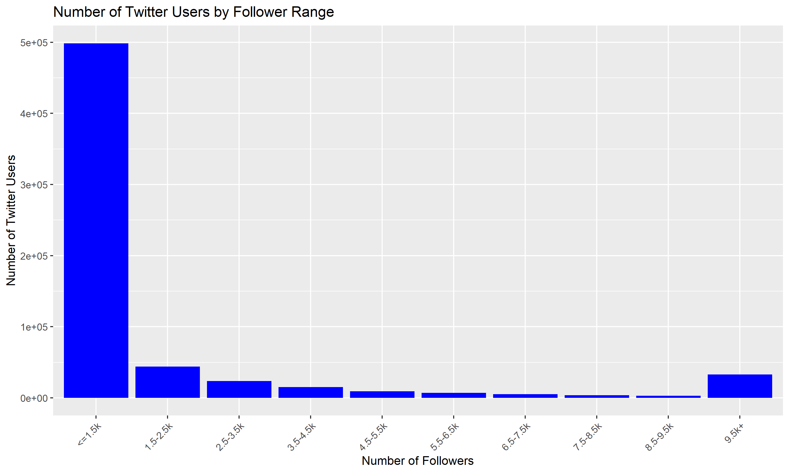

# COVID-19 Tweets Analysis

Analysis of **1.14 million COVID-19 tweets** from **642,000 unique users**: big-data processing with Unix shell pipelines, visualised in R.

## What it does
1. **Processes the raw 118 MB tweet dump** with Unix pipelines (`gunzip | awk | sort | uniq | grep`) to count tweets and unique users, search topics like "vaccine", and separate retweets from original tweets
2. **Groups Twitter users by follower count** into ranges
3. **Visualises** the distribution with `ggplot2` and compares all tweets against non-retweets

## Files
| File | Purpose |
|---|---|
| `follower_range_chart.R` | Bar chart of users per follower range |
| `retweet_vs_original_chart.R` | Side-by-side comparison of all tweets vs original (non-retweet) tweets |
| `*.csv` | Aggregated counts produced from the raw data |
| `sample_tweets.txt` | Sample of filtered tweet text |
| `report.pdf` | Full write-up |

> The raw datasets (`corona_tweets.csv.gz`, ~120 MB, and `non_retweet_corona_tweets.gz`, ~38 MB) aren't included because they exceed GitHub's file-size limit.
